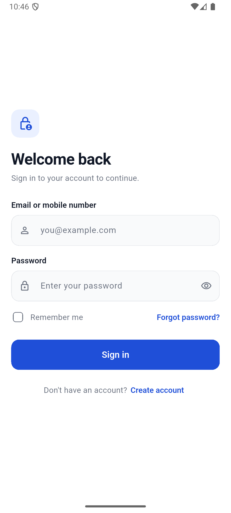
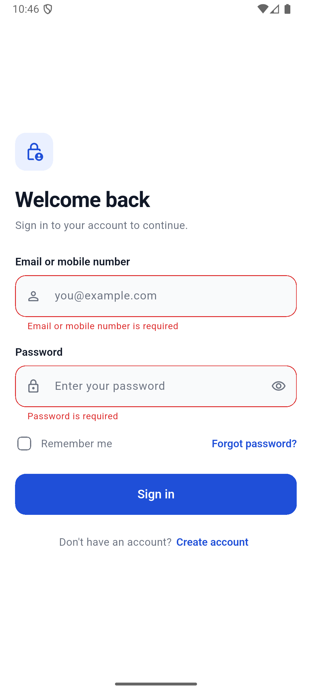
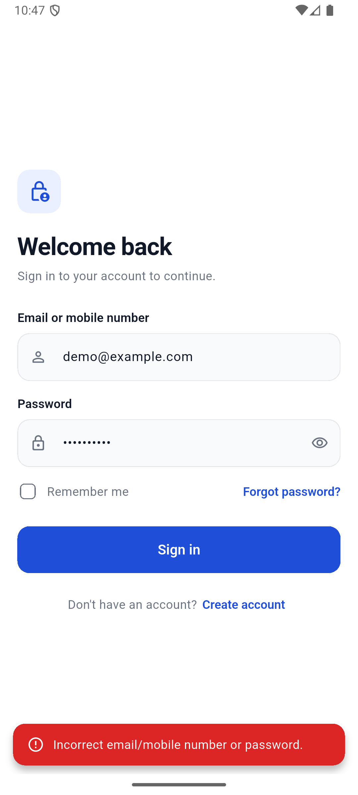
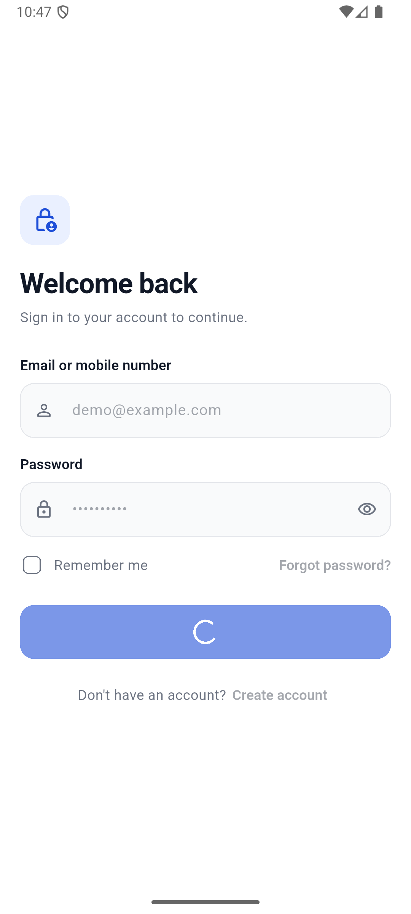
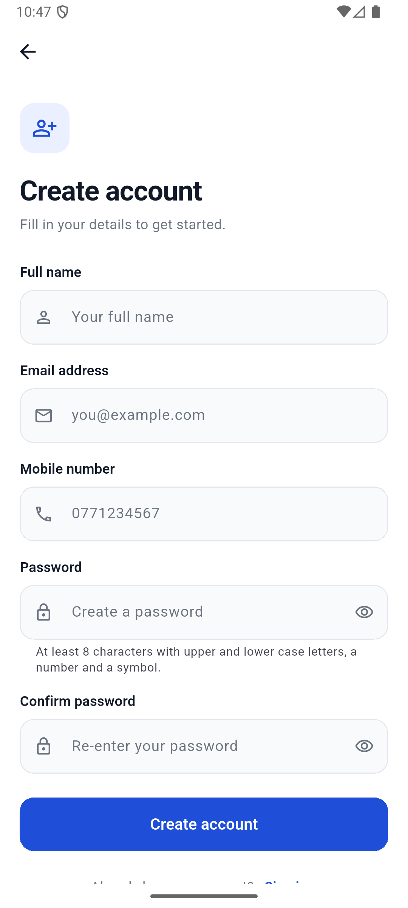
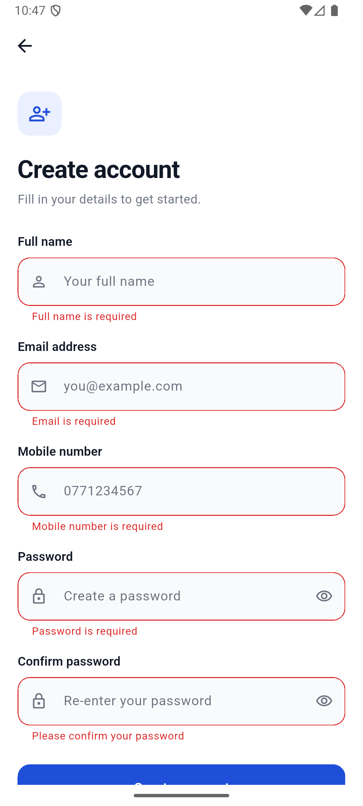
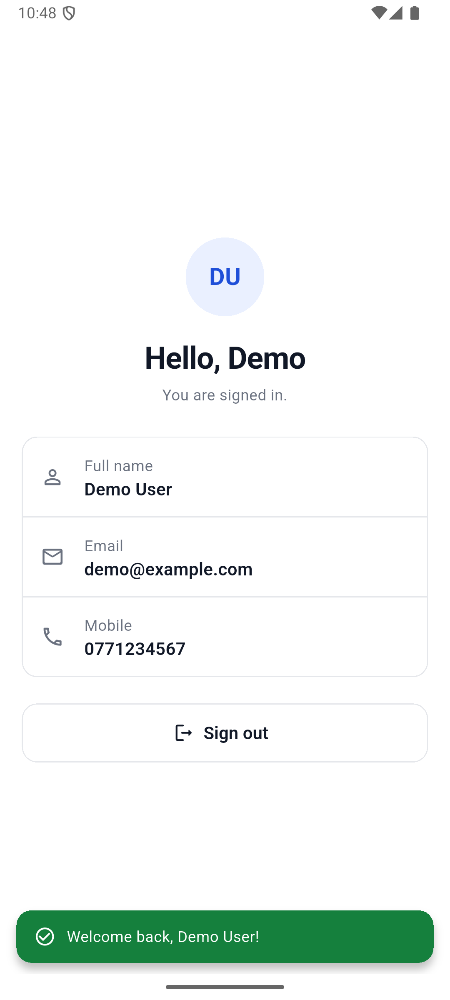

# Flutter Login & Registration Module

A login and registration module built with Flutter, Provider and Material 3 as a Flutter Associate Developer technical assignment. It runs on a mock authentication service that can be swapped for a real REST API by changing one line.

## Features

- **Login** with email or mobile number, show/hide password, Remember Me and clear validation
- **Registration** with field-specific validation and password security rules
- **Forgot password** flow with a confirmation state
- **Home screen** that shows the signed-in user, with sign out
- Loading states, duplicate-submission protection and success/error SnackBars
- Handling for validation, invalid credential, network and unexpected errors
- Responsive layouts for small phones, large phones, tablets and the web
- Reusable text field, password field, button and page layout widgets

## Technologies

| | |
|---|---|
| Framework | Flutter 3.32 (Dart 3.8), Material 3 |
| State management | [provider](https://pub.dev/packages/provider) |
| Local storage | [shared_preferences](https://pub.dev/packages/shared_preferences), for Remember Me only |

## Folder structure

```text
lib/
  main.dart                 Entry point; chooses the AuthService
  app.dart                  MaterialApp, routes and providers
  core/
    constants/              Route names
    exceptions/             Typed failures from the service layer
    theme/                  Colours and Material 3 theme
    validators/             Form validation rules
  models/                   UserModel, AuthResponseModel
  services/
    auth_service.dart       The interface the app depends on
    mock_auth_service.dart  In-memory implementation
  providers/
    auth_provider.dart      Session state: who is signed in
    form_provider.dart      Shared loading, error and success handling
    login_provider.dart
    register_provider.dart
    forgot_password_provider.dart
  screens/                  login, register, forgot_password, home
  widgets/                  Reusable UI
test/                       Unit and widget tests
```

## Architecture

```text
Screen  ->  Form provider  ->  AuthProvider  ->  AuthService  ->  MockAuthService
(UI)        (form state)       (session)         (interface)      (or a real API)
```

- **Screens only handle UI.** They validate the form, call a provider and react to the result.
- **`FormProvider`** holds the logic every form shares: the loading flag, the duplicate-submission guard, and turning exceptions into messages. The three form providers stay very small because of it.
- **Form providers are created per route**, so a screen always opens with clean state. `AuthProvider` is app-wide because the session outlives any one screen.
- **Failures are exceptions.** The service returns an `AuthResponseModel` on success and throws an `AppException` subclass on failure. Anything else is treated as unexpected and shown as a generic message.

## Getting started

Requires Flutter 3.32 or newer.

```bash
git clone https://github.com/PasanSasmika/Flutter-Login-Registration-Module.git
cd Flutter-Login-Registration-Module
flutter pub get
flutter run
```

Run the checks with:

```bash
flutter analyze
flutter test
```

## Mock credentials

| Field | Value |
|---|---|
| Email | `demo@example.com` |
| Mobile | `0771234567` |
| Password | `Demo@1234` |

You can also register a new account. Registered accounts are kept in memory, so they are lost when the app restarts.

## Mock API behaviour

Every request waits 1.2 seconds to simulate a real API call.

| Action | Input | Result |
|---|---|---|
| Login | Correct credentials | Signed in, opens Home |
| Login | Wrong password or unknown user | "Incorrect email/mobile number or password." |
| Register | New email and mobile | Account created, returns to Login with the email filled in |
| Register | Email already registered | Error on the email field |
| Register | Mobile already registered | Error on the mobile field |
| Forgot password | Any valid email | Same confirmation whether or not the account exists, so the form can't be used to discover registered users |
| Any | `network@example.com` as the email | Simulated network error |
| Any | `crash@example.com` as the email | Simulated unexpected error |

Validation rules:

- **Full name:** at least 3 characters
- **Mobile:** 9 to 15 digits with an optional leading `+`; spaces, dashes and brackets are ignored
- **Password:** at least 8 characters with upper and lower case letters, a number and a special character

Remember Me saves the email or mobile number on the device and fills it in next time. The password is never saved.

## Using a real API

1. Create a class that implements `AuthService`, for example `ApiAuthService`.
2. Parse responses with `AuthResponseModel.fromJson`, and throw the matching `AppException` for failures. For example, throw `ValidationException` with a field error map on a 422.
3. Pass it to `App` in `lib/main.dart`.

No provider or screen needs to change.

## Screenshots

| Login | Validation | Incorrect credentials |
|---|---|---|
|  |  |  |

| Loading | Registration | Registration validation |
|---|---|---|
|  |  |  |

| Forgot password | Reset link sent | Home |
|---|---|---|
|  |  |  |
